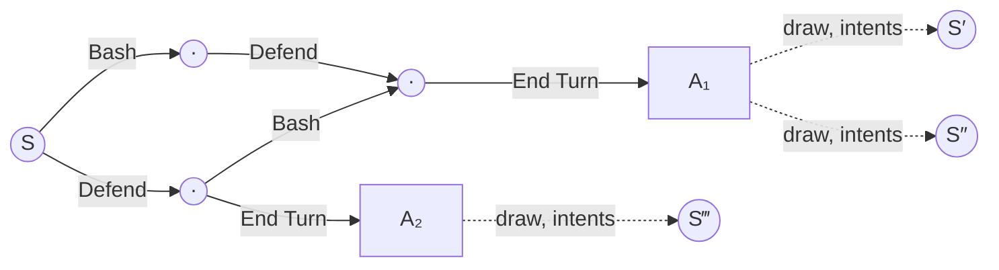

# Turn-graph search

The planned direction for the combat search: fewer network calls at equal strength, by treating a fight as what it is,
deterministic turns separated by chance. Progress and order are tracked in issue #173. This page is the design.

## A fight's search graph

- **Decision nodes** (circles): the player's own choices. Nothing random happens between them; card orders merge.
- **Afterstates** (boxes): the state just before a chance event. End Turn is the largest one: enemies have acted,
  the next hand is not yet drawn.
- **Chance outcomes** (dotted): draws, shuffles, intents, random targets, generated cards.

Mid-turn chance (Havoc, draw cards, random targets) splits a turn into several deterministic segments, each
separated from the next by an afterstate.

## Rules

| Where | Value of a node | Backup |
|---|---|---|
| Decision node | its best continuation | soft maximum over children; sharpness from value uncertainty |
| Afterstate | expectation over what chance picks | mean |

- A chance step mislabelled as deterministic would take a max over particles ("assume the lucky world"), so a step
  counts as chance whenever it touches RNG or hidden state.
- At End Turn the search stops at the afterstate and values it directly: first as the mean of its particle children in
  one batched query, later with an afterstate value head. It looks past End Turn only for afterstates that could still
  be the best line.
- Mid-turn chance outcomes stay in the graph. They have few distinct outcomes, and those merge by observation key.

## Budget

- The improved policy is `softmax(logits + β·Q̃)`. Q̃ is Q shrunk toward the node value by its evidence, and β does not
  depend on the visit count. Policy targets therefore mean the same thing at any budget.
- A search stops once more evaluations could not move its policy target by more than δ.
- The graph is reused across a turn's decisions. A reused node is topped up only until the stop rule fires; a node
  reached through a chance reveal starts fresh.

## Parameters

Each is set in win probability or policy probability, and converted internally.

| Knob | Meaning | Internal |
|---|---|---|
| Δ | a Δ win-probability edge is worth a 10× prior ratio | β = ln 10 / Δ |
| δ | stop when the policy target can't move by more than δ (total variation) | KL threshold 2δ² |
| p | look past End Turn only for afterstates with at least p chance of being best | from values and their uncertainty |
| ceiling | network calls per turn | safety cap |
| Gumbel scale | root exploration | unchanged |

These replace `simulations`, `value_scale`, `maxvisit_init` and, probably, `considered_actions`.

## Evaluation

A change is kept only if it beats the fixed-budget curve of win rate against network calls per fight, on the
marginal-fight set re-run on fresh seeds (#166).
